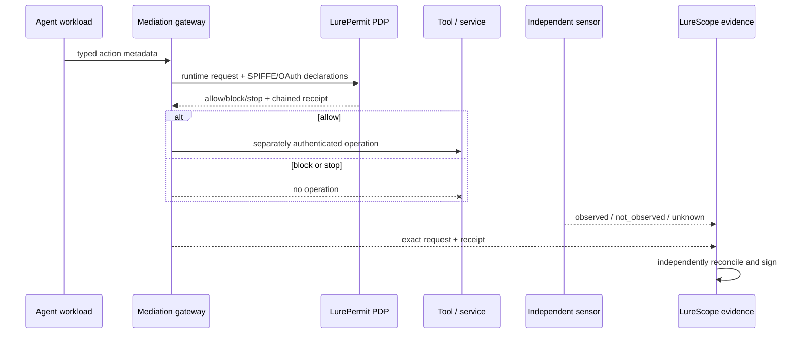

# Runtime authorization and mediation assurance for AI agents

LurePermit Runtime turns the offline permit contract into a side-effect-free
policy decision point (PDP), hash-chained decision receipts, independent sensor
reconciliation, and stateful adversarial trajectories. It is designed for teams
that need to test and integrate agent authorization without placing prompts,
commands, payloads, target locations, credentials, tokens, or model reasoning in
the evidence plane.

This is a research-pilot control and evidence contract. It is not a credential,
policy-enforcement proxy, compliance result, or claim that every action was
mediated.

The local runtime service accepts at most 64 KiB per decision request and checks
JSON complexity before decoding or entering the decision engine: 4,096 nodes,
128 container levels, and 4,096 characters per unquoted token. Each object key,
container, and scalar value counts as one node. Excess complexity raises a
validation error (HTTP 400) without appending a decision receipt. These are
per-request limits, not concurrent-connection, timeout, or process-memory limits.

The shared `loads_strict_json` evidence reader defaults to 1,000,000 nodes;
callers retain their own byte limits. Previously accepted high-complexity
documents may now be rejected. Existing duplicate-key, UTF-8, and finite-number
requirements remain in force, and no stored evidence is rewritten. JSON resource
limits are permitted by [RFC 8259 section 9](https://www.rfc-editor.org/rfc/rfc8259.html#section-9);
the particular budgets are project choices, not a compliance guarantee.

## Why this exists

Recent primary guidance converges on a system-level problem:

- The February 2026 [NIST NCCoE Software and AI Agent Identity and Authorization
  concept paper](https://www.nccoe.nist.gov/publications/other/accelerating-adoption-software-and-ai-agent-identity-and-authorization-concept)
  frames agent identity, authentication, authorization, delegation, human
  binding, audit, and non-repudiation across workforce-assistant, security-agent,
  and software-deployment use cases. It is a concept paper, not a final standard.
- [NIST SP 800-207A](https://doi.org/10.6028/NIST.SP.800-207A) describes
  identity-tier policy enforcement using API gateways, sidecars, service meshes,
  and workload identity such as SPIFFE.
- The [MCP authorization specification](https://modelcontextprotocol.io/specification/2025-06-18/basic/authorization)
  requires resource indicators and audience validation and prohibits forwarding
  a client token unchanged to an upstream service.
- OpenAI's August 2026 [Hugging Face incident report and response](https://openai.com/index/hugging-face-incident-and-the-road-ahead/)
  identifies the need for stronger workload/network isolation, continuous
  security testing, safe stopping on broken or impossible tasks, multi-agent and
  long-task alignment, and clearer tiered incident response.

LurePermit Runtime converts those themes into bounded, testable metadata
contracts. It does not claim endorsement by any cited organization.

## Architecture



Only the gateway is positioned to enforce. The PDP evaluates typed metadata and
never calls `T`. The sensor is independent evidence input; declaring a sensor ID
does not authenticate the sensor or prove coverage.

## What is implemented

| Control | Runtime behavior |
|---|---|
| Workload identity | Spec-bounded canonical SPIFFE ID and explicit trust-domain allowlist |
| Human authority | High-impact actions bind an operator, approval ID, and exact request digest |
| Delegation and peers | Bounded depth; revoked or unauthorized peers safe-stop |
| OAuth/OIDC metadata | MCP resource and audience binding; agent actor binding; no token values |
| Token isolation | Token passthrough safe-stops; upstream services require a separate exchanged token |
| Policy freshness | Revoked/expired permits and stale policy generations safe-stop |
| Long tasks | Impossible/corrupted task states safe-stop; stopped runs remain stopped |
| Replay | Nonces and monotonic run sequence are statefully rejected |
| Audit integrity | Receipts bind the exact request and form a SHA-256 predecessor chain |
| Policy correctness | Receipt decisions and reasons are independently derived from stateful profile/permit semantics |
| Enforcement evidence | Registered sensors distinguish effective, bypassed, unmediated, unknown, and incomplete effects |
| Coverage | Request coverage and distinct mediation-point coverage are measured separately |

## Five-minute local evaluation

```bash
lurebench runtime-init --out runtime-profile.json
lurebench runtime-trace --out runtime-trace.json
lurebench runtime-eval \
  --trace runtime-trace.json \
  --out runtime-evaluation.json
lurebench stateful-range-export --out stateful-suite.json
lurebench stateful-range-eval \
  --suite stateful-suite.json \
  --out stateful-evaluation.json
```

The reference runtime trace has 11 typed requests across all nine registered
mediation points. The stateful range contains 15 trajectories and 22 steps for
safe stopping, unauthorized peers, shared-state signaling, transitive package
egress, credential reuse, token passthrough, wrong audience, approval rebinding,
permit revocation, policy rollback, excessive delegation, sensor suppression,
replay, and evaluator tampering.

Outputs are canonical JSON, mode `0600` on POSIX, and never overwrite an
existing path. Exit `0` is a pass, `1` is a valid failing evaluation, and `2` is
invalid input or an I/O failure.

## Run the decision service

```bash
lurebench permit-serve \
  --host 127.0.0.1 \
  --port 8765 \
  --max-connections 16 \
  --decision-wait-seconds 1 \
  --max-decisions 512 \
  --receipt-log receipts.jsonl
```

For a local same-UID socket, provision `/run/lurepermit` as a dedicated directory
owned by the service's effective UID with mode `0700` before starting:

```bash
lurebench permit-serve \
  --unix-socket /run/lurepermit/decision.sock \
  --receipt-log receipts.jsonl
```

The service refuses non-loopback IPs, caps request bodies at 64 KiB, accepts
strict JSON only, does not overwrite its receipt log, writes it mode `0600`, and
uses `fsync` after each receipt. `/openapi.json` and the packaged
[`lurepermit-runtime-openapi-v1.json`](../spec/lurepermit-runtime-openapi-v1.json)
describe the API. Socket/file permissions are local access controls; production
deployments still need OS/container isolation and authenticated workload identity.

### Unix-socket ownership and cleanup

Unix mode requires an existing **mode-0700 directory owned by the service's
effective UID**. The final parent component must not be a symlink; the platform
must support no-follow directory opening and directory-relative filesystem
operations. Existing socket, file, directory, and symlink entries are refused,
including dangling symlinks. Abstract/NUL socket names and `..` components are
unsupported. Relative socket paths are anchored at startup, without changing
the process working directory or umask. The service does not create, chmod, or
remove the parent directory. This is a compatibility change: a shared or
mode-0755 parent that previously worked must be replaced with a dedicated private
directory, not broadly relaxed permissions elsewhere.

The server retains a non-inheritable directory descriptor, checks the parent
identity around binding, and records the socket's inode and metadata. It sets
socket mode `0600` before listening. On shutdown or activation/application
failure, including interruption, cleanup compares a no-follow metadata snapshot
relative to that descriptor and unlinks only the matching entry. Observed
replacement files, sockets, symlinks, changed socket metadata, and missing paths
are not adopted or removed. If the directory is renamed, cleanup remains anchored
to the original directory rather than following a newly created pathname.
Repeated cleanup never reacquires ownership of a later entry.

Uncertain setup, changed permissions, or failed cleanup can leave an entry for
operator inspection. Cleanup releases the listening socket and directory
descriptor even if unlink fails; a primary startup error is retained with a
cleanup note. CLI interruption with a cleanup failure exits `2`, not silent
success. Do not blindly delete an existing socket to restart: establish which
process owns it and whether the previous service and its workers have stopped.
Cleanup does not terminate active daemon workers or recover uncertain receipts.

This is **not atomic compare-and-unlink** or isolation from a malicious process
with the same UID, a privileged actor, or an administrator changing the directory
during startup. Directory-relative bind is not available through the portable
socket API, and metadata checking plus unlink/chmod is not one atomic operation.
Keep the directory's ancestors, mounts, and ACLs under trusted administration;
mode bits alone do not validate ACLs or certify filesystem behavior. No-follow
chmod is used when supported, with the private-directory requirement retained
on platforms that lack it. If isolation between untrusted local workloads is
required, use distinct identities and OS/container controls.

The design uses [Python directory-relative filesystem operations](https://docs.python.org/3.13/library/os.html#files-and-directories)
and the [socketserver lifecycle](https://docs.python.org/3.13/library/socketserver.html#socketserver.BaseServer.server_close).
The [Linux Unix-socket documentation](https://man7.org/linux/man-pages/man7/unix.7.html)
also distinguishes directory access controls from nonportable socket-file
permission behavior. These references do not establish a cross-platform
security certification.

### HTTP admission and failure handling

Before framework parsing, the complete request line plus header section has a
**16 KiB wire-byte budget** and a **five-second total read deadline**, shared by
GET/HEAD/POST and all paths. A terminating blank line is required. The byte budget
includes line endings and the blank line, not prefetched body bytes. The deadline
starts when the handler begins collecting the head; byte/line progress does not
restart it. These are pilot defaults, not standards-mandated thresholds.

An oversized aggregate head returns 431 `request_head_too_large`; a request line
alone exceeding the same budget returns 414 `request_line_too_large`. Expiration
returns 408 `request_head_timeout`. Incomplete heads at EOF return 400
`incomplete_request_head`; other read errors return 400 `request_head_unavailable`.
An empty EOF simply closes. Each is before readiness, policy evaluation, nonce
consumption, or receipt logging; failures do not poison application readiness.
Responses are fixed/redacted and close the connection, but delivery is not
guaranteed if the peer disconnects or continues writing. HEAD errors omit bodies
once its complete request line is recognized. Versionless/HTTP-0.9 requests are
unsupported instead of returning raw unframed JSON.

Collection uses bounded `read1` calls with a decreasing timeout, then replays the
complete head into the existing HTTP parser. Any body prefix is preserved exactly;
body collection has its own subsequent deadline. The framework's header-count
and syntax checks still apply. LF-only lines remain accepted as by the framework;
this is not a replacement general-purpose HTTP parser or a request-smuggling
certification. The [Python stream contract](https://docs.python.org/3.13/library/io.html#io.BufferedReader.read1)
and [431 status semantics](https://www.rfc-editor.org/rfc/rfc6585.html#section-5)
inform this bounded preflight.

The source-branch HTTP endpoint accepts a single decimal `Content-Length` and
one `Content-Type: application/json` header. Media-type parameters are tolerated,
but the body must be strict UTF-8 JSON. Duplicate length or content headers,
comma-combined lengths, signed/nondecimal lengths, and folded headers return
400 before decision evaluation. A missing length returns 411; a body over
64 KiB returns 413. All `Transfer-Encoding` headers are rejected with 400;
chunked upload is not supported by this narrow service. Only absent or a single
`Content-Encoding: identity` is accepted; other encodings return 415.
`Expect`, including `100-continue`, returns 417 without reading the body.

Body reads have a five-second total deadline measured after header admission,
using a monotonic clock. Partial arrival does not restart this deadline. A body
that ends before its declared length returns 400; expiration returns 408.
Neither reaches the decision engine or appends a receipt. Socket operations have
a separate five-second idle timeout; the head deadline above additionally bounds
total header collection. Separate worker/admission bounds are described below;
decision/storage execution duration remains unbounded. Neither read deadline
is an end-to-end response-time guarantee or cancellation of running decisions.

Every response closes the connection. Pipelining and persistent connections
are not supported; unread bytes are not interpreted as another request.
HTTP errors use fixed JSON codes rather than echoing submitted keys, request
lines, identifiers, or exception details. Direct Python callers retain their
validation exceptions. Framework parse/method errors are also redacted;
unsupported HEAD requests have no response body.

The caller must fail closed on any transport or processing failure. HTTP 503
with `runtime_unavailable` means the application has latched a storage or uncertain
decision-state failure and requires operator recovery. HTTP 500 remains the
handler's fallback for unexpected errors outside that guarded application flow.
A processing failure or lost response can occur after in-memory replay/receipt
state changes; do not automatically retry or treat an absent response as an
allowed operation.

This application profile intentionally rejects ambiguous framing identified in
[RFC 9112 section 6.3](https://www.rfc-editor.org/rfc/rfc9112.html#section-6.3).
It is not a general HTTP/1.1 implementation or a request-smuggling certificate.
Python explicitly [does not recommend `http.server` for production](https://docs.python.org/3.13/library/http.server.html).
Keep this pilot on loopback or a protected Unix socket, behind separately
managed authentication, isolation, concurrency limits, and operational supervision.

### Bounded connection and decision admission

TCP (IPv4/IPv6 loopback) and Unix sockets share a bounded worker implementation.
`--max-connections` defaults to 16 and accepts integers from 1 through 256. A
slot covers an admitted connection from worker creation through handler/socket
cleanup, including slow reads, decision waiting, and response writes. At capacity,
an accepted socket is closed immediately, without reading, allocating a handler,
or attempting an HTTP response. The operating-system listen backlog is separate.
This is not a process-wide memory or thread-count limit.

`--decision-wait-seconds` defaults to one second and accepts finite numbers from
0 through 30; zero means no waiting. Direct Python applications accept the same
keyword. A request that cannot acquire the application's decision lock raises
`RuntimeDecisionBusy`, mapped to HTTP 503 `{"error":"runtime_busy"}`. That
request has not entered the engine, consumed replay state, or appended a receipt.
Busy admission does not latch a storage failure or reset a run. Successfully
admitted work remains serialized. No fairness or FIFO ordering is promised.

The wait limit is **not an execution timeout**: it does not cancel a running
decision or interrupt `fsync`. The application may still be handling an earlier
request. A definite `runtime_busy` response is distinct from `runtime_unavailable`
or a lost response; never interpret any of them as authorization. A retry needs
the caller's normal request/freshness policy, and ambiguous earlier requests
must be reconciled rather than silently replayed.

Unix requests are no longer processed serially in the accept loop. A health
request can progress during an in-flight write if a worker slot is available.
Health has no reserved capacity and remains a failure-latch snapshot: a 200
does not prove that storage is progressing, another decision can be admitted,
or capacity is available. Slow/repeated senders can still occupy every slot
within the head/body budgets. Use an external gateway and process supervisor;
there is no fair per-client admission, transport-wide rate cap, or denial-of-service guarantee.

Worker-start failures/interruption stop further transport admission. A failed
start can already have created a worker, so its slot is not speculatively
released; only worker cleanup releases it. Restart requires operator review of
any in-flight outcomes. Threads are daemon workers: shutdown does not join or
cancel stuck engine/storage work, restore state, or guarantee final delivery.
Invalid limit values fail before binding sockets or creating receipt files.
The CLI prints `STARTING`, not a premature readiness assertion; probe `/health`
after startup. None of these controls makes the pilot a production HTTP server.

The implementation uses Python's [bounded semaphore](https://docs.python.org/3.11/library/threading.html#threading.BoundedSemaphore)
and [threaded server lifecycle](https://docs.python.org/3.11/library/socketserver.html#socketserver.ThreadingMixIn).
The numeric limits are project defaults, not standards-mandated thresholds.

### Session lifetime and replay-state bounds

The existing v1 receipt schema permits at most 512 receipts per engine. The
engine now checks that ceiling **before evaluation**, rather than advancing
replay state and then rejecting receipt 513. `--max-decisions` (or the Python
application keyword `max_decisions`) can lower the service budget to 1..512;
it defaults to 512. Every emitted allow/block/stop receipt consumes one slot,
including replay denials. Malformed inputs and busy admission do not.

The last admitted decision can return its valid receipt. Later decisions receive
HTTP 503 `{"error":"runtime_exhausted"}` (`RuntimeDecisionExhausted` in Python),
without entering the engine. Direct `RuntimePDP.decide` raises
`RuntimeCapacityExceeded` at its 512-receipt ceiling. Health becomes 503 with
`reason: decision_limit_reached`. The `decision_budget` object reports `limit`,
`evaluated`, and `remaining`; evaluated counts committed engine decisions, not
successful persistence, delivery, or allowed actions. A final write may still
be in progress. Observed storage/engine failures take precedence over exhaustion.

Receipt validation, hashing, and history allocation precede publication of one
immutable in-memory state snapshot. Direct engine calls are serialized; failed
receipt preparation does not consume a nonce or chain position. History is never
evicted to regain capacity, and each history has at most 512 entries. This is
not durable state, transactional persistence, automatic recovery, or a total
memory bound. There is no reset/automatic rotation: stop protected operations,
reconcile the completed session and any uncertain outcomes, and explicitly
establish a new context under operator control. Restarting loses replay history.

### Audit failure and operator recovery

Use a dedicated, unused `RuntimePDP` with every application, including memory-only
mode. Do not share
it between application instances or invoke it directly while the service owns
it. Application construction refuses an engine that has already produced receipts.
The application serializes its own decisions and appends under one lock.

The receipt log must remain a single-link regular file, private on POSIX. The
application records its device/inode, size, timestamps, mode, and link count at
creation and after each successful append. Changes observed before evaluation,
on opening, or after writing reject the operation. Log rotation, external
writers, truncation, permission changes, hard links, symlinks, and replacement
are unsupported. Parent directories and ancestors must remain trusted; metadata
checks are not cryptographic verification of all file bytes or an atomic
filesystem snapshot.

A receipt is returned only after a complete write, flush, `fsync`, close, and
final file check. If serialization or any persistence step fails, the application
latches `receipt_log_failed`, withholds the result, and rejects subsequent
admitted decisions before entering the engine. Waiting requests cannot pass the
latch. An unexpected error after validated input enters the stateful engine
latches `decision_state_uncertain`, including in memory-only mode. Malformed
JSON and ordinary request-validation failures do not latch either failure.
Interruptions during guarded work set the latch before propagating the interrupt.

`GET /health` returns 503 after a latched failure; its body exposes only `ready`,
`status`, a fixed `reason`, `decision_budget`, `receipt_logging`, and
`executes_actions: false`.
The expanded 200 response reports the same fields with `reason: ready`.
`RuntimeDecisionApplication.readiness()` provides the same non-blocking snapshot.
It does not probe disk health, discover external edits before the next operation,
or detect a stalled write. Memory-only mode can report ready with
`receipt_logging: false`; it makes no persistence claim.

There is no reset endpoint or automatic repair. Restoring the file, retrying,
or disabling logging does not clear the instance's latch. Preserve partial or
complete uncertain log bytes, stop protected operations, and investigate the
failure with the associated requests and trusted external evidence. Do not
truncate a partial tail or restart against a fresh log merely to regain a green
health check. Reconcile the audit chain and replay history before explicitly
establishing a new runtime context. The service does not restore state on restart,
rollback a decision, or provide an exactly-once/crash-atomic transaction. Response
loss after persistence also remains an uncertain delivery outcome.

[Python's `fsync` documentation](https://docs.python.org/3.13/library/os.html#os.fsync)
requires flushing buffered output first. The
[write system-call documentation](https://man7.org/linux/man-pages/man2/write.2.html)
explains partial writes. These motivate the checked append and fail-stop policy;
they do not establish end-to-end crash durability across filesystems or hardware.

## Integrate an enforcement point

1. Authenticate the caller outside LureBench. Obtain the SPIFFE ID from a
   verified workload certificate, not a request body.
2. Validate OAuth/OIDC issuer, signature, expiry, audience, subject, and actor.
   Never pass the raw token to LurePermit or its logs.
3. Convert the intended operation to `build_permit_request`, then wrap it with
   `build_runtime_request`. The representation must contain metadata only.
4. Send it to `RuntimePDP.decide` or local `/v1/decide` before executing the
   operation.
5. Fail closed on transport errors, malformed decisions, mismatched request IDs,
   sequence numbers, or digests.
6. Execute an allowed operation in a separately secured component. The decision
   is not the operation.
7. Record independently produced sensor observations for the registered
   mediation point. Preserve `unknown`; never translate it to success.

SPIFFE parsing is shared with LureIdentity and enforces the stable
specification's 2,048-byte ID, 255-byte trust-domain, forbidden URI-component,
and path-segment rules. Workload IDs require a non-root path. See the
[validation and authentication boundary](SPIFFE_ID_VALIDATION.md).
8. Build a trace and run `runtime-eval`. Sign the resulting independent evidence
   with LureScope.

The adapters in `lurebench.runtime_adapters` translate to or from MCP, OPA,
Cedar, Envoy ext_authz-style attributes, and SPIFFE declarations without making
network calls. They do not validate certificates/tokens and do not run the
external policy engine. See [`examples/runtime`](../examples/runtime/README.md).

Before claiming that revocation reaches this runtime surface, use
`lurebench revocation-topology-audit` to reconcile a LureRevoke plan with every
declared mediation point in this profile. Missing or unknown mappings fail; the
audit does not perform service discovery or prove deployment topology.

## Reconciliation semantics

| Receipt | Sensor effect | Classification | Meaning within submitted evidence |
|---|---|---|---|
| allow | observed | `effective` | allowed effect was observed |
| allow | not observed | `incomplete_effect` | receipt exists but effect was not observed |
| block/stop | not observed | `effective` | denied effect was not observed |
| block/stop | observed | `control_bypass` | denied effect was observed |
| missing | observed | `unmediated` | effect exists without a bound decision receipt |
| any/missing | missing, mixed, or unknown required sensors | `unknown` | evidence cannot determine effect |

`effective` is intentionally narrow. It does not prove the sensor was truthful,
that no alternate path existed, or that every operation was submitted. It also
does not override policy correctness: decision and reason accuracy are separate
mandatory acceptance gates.

## NIST concept-paper implementation mapping

The machine-readable demonstration mapping is
[`docs/nist/agent-identity-demonstration.yaml`](nist/agent-identity-demonstration.yaml).
It records implemented, adapter-only, and external responsibilities separately.
Highlights:

| Capability | Status |
|---|---|
| Unique agent/workload identity binding | Implemented metadata contract; external authentication required |
| Human-on-behalf-of binding | Implemented for declared high-impact actions |
| Delegation constraints | Implemented and statefully evaluated |
| MCP/OAuth audience and token-exchange boundary | Implemented metadata decision; external token validation/exchange required |
| SPIFFE | Canonical ID/trust-domain validation; Workload API verification external |
| OPA, Cedar, Envoy | Offline translators and strict response bindings; deployment external |
| SCIM | RFC 7643 lifecycle metadata projection and LureIdentity closure benchmark; protocol/authentication external |
| NGAC | Not implemented; LureIdentity graph semantics are not an NGAC conformance claim |
| Audit/non-repudiation | Chained receipts; organizational non-repudiation requires signed LureScope evidence and key governance |

## Claims and safety boundary

A pass means the submitted request, receipt, and sensor metadata reconcile under
the embedded profile and acceptance thresholds. It does not establish that every
agent action traversed a gateway, that identities or sensors were authentic, that
an infrastructure was contained, or that a system satisfies NIST, FedRAMP,
FISMA, CMMC, SOC 2, ISO 27001, or another requirement. OSCAL export from
LureScope is observation-only and deliberately contains no findings.
